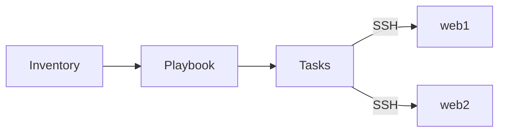

Ansible connects to the hosts from an **inventory** over SSH and runs **tasks**, each calling a **module** that
describes a desired state ("package installed", "file present"). Running the same playbook twice changes nothing the
second time.



## Building blocks

```yaml title="inventory.yml"
all:
  children:
    webservers:
      hosts:
        web1:
          ansible_host: 192.168.1.101
        web2:
          ansible_host: 192.168.1.102
      vars:
        http_port: 80
```

```yaml title="site.yml"
- name: Set up web servers
  hosts: webservers
  become: true # run tasks with sudo
  tasks:
    - name: Install nginx
      ansible.builtin.package:
        name: nginx
        state: present

    - name: Deploy the config
      ansible.builtin.template:
        src: nginx.conf.j2
        dest: /etc/nginx/nginx.conf
      notify: Reload nginx # handler runs once at the end, only if this task changed something

  handlers:
    - name: Reload nginx
      ansible.builtin.service:
        name: nginx
        state: reloaded
```

A role packages tasks, handlers, templates and variables for reuse. Only the directories you need have to exist; Ansible
loads each `main.yml` automatically.

```text title="roles/webserver/"
defaults/main.yml    # default variables, lowest precedence
tasks/main.yml       # the tasks
handlers/main.yml    # handlers
templates/           # Jinja2 templates for the template module
files/               # static files for the copy module
meta/main.yml        # dependencies and argument specs
```

My own roles are documented under [Ansible Collections](/projects/).

## Variable precedence

When the same variable is defined in several places, the later source in this list wins (simplified):

1. role `defaults/`
1. inventory `group_vars` (`all` first, then more specific groups)
1. inventory `host_vars`
1. play `vars`
1. role `vars/`
1. task `vars`
1. extra vars (`-e`), which always win

:::tip
Put everything a user should be able to change into `defaults/main.yml` of the role. Role `vars/` beat inventory
variables, so values there are hard to override.
:::

## Commands

| Command                                                  | Effect                                                    |
| -------------------------------------------------------- | --------------------------------------------------------- |
| `ansible-playbook -i inventory.yml site.yml`             | Runs a playbook.                                          |
| `ansible-playbook site.yml --check --diff`               | Dry run that shows what would change.                     |
| `ansible-playbook site.yml --limit web1`                 | Runs only on some hosts.                                  |
| `ansible-playbook site.yml --tags nginx`                 | Runs only tasks with that tag.                            |
| `ansible-playbook site.yml -K`                           | Asks for the sudo password (`become`).                    |
| `ansible-playbook site.yml -e http_port=8080`            | Sets a variable with the highest precedence.              |
| `ansible webservers -m ping`                             | Ad-hoc module call, here a connection test.               |
| `ansible all -m setup -a 'filter=ansible_distribution*'` | Shows gathered facts.                                     |
| `ansible-inventory --graph`                              | The inventory as a tree of groups and hosts.              |
| `ansible-doc ansible.builtin.template`                   | Documentation and examples of a module.                   |
| `ansible-vault encrypt secrets.yml`                      | Encrypts a file; run playbooks with `--ask-vault-pass`.   |
| `ansible-galaxy collection install community.general`    | Installs a collection (`-r requirements.yml` for a list). |
| `ansible-galaxy role init webserver`                     | Creates the role directory skeleton.                      |
