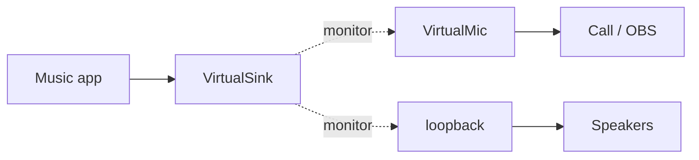

A null sink is an output device that plays into nothing. Every sink has a `.monitor` source that records what is played
into it, so a null sink can collect audio from apps and pass it on, for example to a call or a recording.



The commands use `pactl`, which works on PulseAudio and on PipeWire (through `pipewire-pulse`).

## Create the devices

```sh title="Virtual output"
pactl load-module module-null-sink sink_name=VirtualSink sink_properties=device.description=VirtualSink
```

```sh title="Virtual microphone fed by VirtualSink"
pactl load-module module-remap-source master=VirtualSink.monitor source_name=VirtualMic source_properties=device.description=VirtualMic
```

```sh title="Also hear what is played into VirtualSink"
pactl load-module module-loopback source=VirtualSink.monitor sink=@DEFAULT_SINK@ latency_msec=1
```

Then pick _VirtualSink_ as the output of the app (e.g. in `pavucontrol`), and _VirtualMic_ as the microphone of the
receiving app.

:::tip
Many apps hide monitor sources from their microphone list. That's why the remap source is needed; with it, _VirtualMic_
shows up like a normal microphone.
:::

## Remove the devices

`load-module` prints the ID of the new module. Unload with that ID, or look it up:

```sh
pactl list short modules | grep -E 'null-sink|remap-source|loopback'
pactl unload-module <module_id>
```

```sh title="Remove all modules of one type"
pactl unload-module module-loopback
```

:::note
Modules loaded with `pactl` disappear on restart of the sound server or reboot. To keep them, add the `load-module`
lines to `~/.config/pulse/default.pa` (PulseAudio) or define the nodes in `~/.config/pipewire/pipewire.conf.d/`
(PipeWire).
:::
