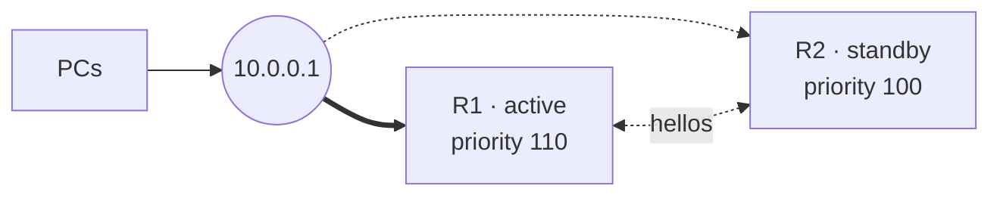
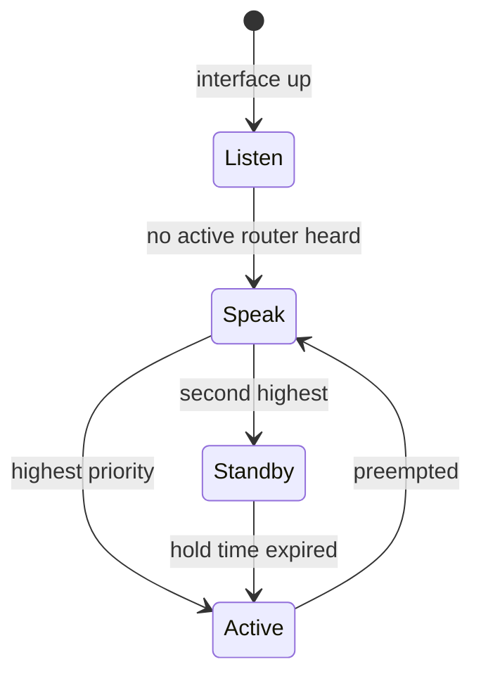

HSRP (Cisco-proprietary) lets two or more routers share one **virtual IP** that clients use as their default gateway. One
router is _active_ and answers for the virtual IP; a _standby_ router takes over when the active one stops sending hellos.



## Configuration

Configure the same group number and virtual IP on every router; only the priority differs.

```text title="R1"
R1# configure terminal
R1(config)# interface GigabitEthernet0/0
R1(config-if)# ip address 10.0.0.2 255.255.255.0
R1(config-if)# standby version 2
R1(config-if)# standby 1 ip 10.0.0.1
R1(config-if)# standby 1 priority 110
R1(config-if)# standby 1 preempt
R1(config-if)# standby 1 track GigabitEthernet0/1 20
R1(config-if)# end
R1# write memory
```

| Command                                 | Effect                                                                             |
| --------------------------------------- | ---------------------------------------------------------------------------------- |
| `standby <group> ip <vip>`              | Joins the group and sets the virtual IP.                                           |
| `standby <group> priority <0-255>`      | Highest priority becomes active; ties go to the highest interface IP. Default 100. |
| `standby <group> preempt`               | Lets a higher-priority router take the active role back after it recovers.         |
| `standby <group> track <if> <n>`        | Lowers the priority by `n` when the tracked (uplink) interface goes down.          |
| `standby <group> timers <hello> <hold>` | Hello and hold time in seconds. Default 3 and 10.                                  |
| `standby version 2`                     | Groups 0–4095, IPv6 support and millisecond timers. Must match on all routers.     |

:::tip
Without `preempt`, the router that became active stays active even after a router with a higher priority comes back.
Tracking only helps together with `preempt` on the standby router.
:::

## States



Before _Listen_ a router passes _Initial_ and _Learn_ (waiting for the virtual IP). Routers that are neither active nor
standby stay in _Listen_.

## Verification

| Command                | Shows                                                            |
| ---------------------- | ---------------------------------------------------------------- |
| `show standby brief`   | Group, priority, state, active and standby router per interface. |
| `show standby`         | Details including timers, tracked objects and the virtual MAC.   |
| `debug standby events` | State changes as they happen.                                    |

The virtual MAC is `0000.0c07.acXX` for version 1 and `0000.0c9f.fXXX` for version 2, where `X` is the group number in
hex. Clients keep this MAC in their ARP cache, so a failover needs no ARP update.
