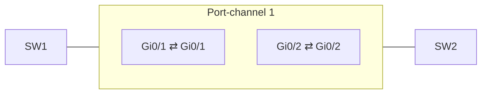

A port channel (EtherChannel) bundles up to eight physical links into one logical interface. STP sees a single link, so
all members forward instead of all but one being blocked. Traffic is spread **per flow**, not per packet: a single
connection never gets more than one member's bandwidth.



## Configuration

Configure the members; the `Port-channel` interface is created automatically. Settings applied to the port channel
afterwards are copied to all members.

```text title="SW1"
SW1# configure terminal
SW1(config)# interface range GigabitEthernet0/1 - 2
SW1(config-if-range)# channel-group 1 mode active
SW1(config-if-range)# exit
SW1(config)# interface Port-channel 1
SW1(config-if)# description uplink to SW2
SW1(config-if)# switchport mode trunk
SW1(config-if)# end
SW1# write memory
```

:::caution
All members need the same speed, duplex, switchport mode and VLANs. A mismatched port is suspended (`s` in
`show etherchannel summary`) instead of joining the bundle.
:::

## Modes

| Mode        | Protocol       | Behavior                                   |
| ----------- | -------------- | ------------------------------------------ |
| `active`    | LACP (802.3ad) | Sends LACP packets and negotiates.         |
| `passive`   | LACP           | Only answers LACP packets.                 |
| `desirable` | PAgP (Cisco)   | Sends PAgP packets and negotiates.         |
| `auto`      | PAgP           | Only answers PAgP packets.                 |
| `on`        | none           | Forces the bundle without any negotiation. |

Which combinations form a channel:

|               | `active` | `passive` | `desirable` | `auto` | `on` |
| ------------- | :------: | :-------: | :---------: | :----: | :--: |
| **active**    |    ✅    |    ✅     |             |        |      |
| **passive**   |    ✅    |           |             |        |      |
| **desirable** |          |           |     ✅      |   ✅   |      |
| **auto**      |          |           |     ✅      |        |      |
| **on**        |          |           |             |        |  ✅  |

:::tip
Prefer `active` on both sides. LACP is a standard (works with servers and other vendors) and detects a cabling mistake,
whereas `on` silently creates a loop or black hole when the far side isn't bundled.
:::

## Verification

| Command                                | Shows                                                                |
| -------------------------------------- | -------------------------------------------------------------------- |
| `show etherchannel summary`            | Each bundle with its members and flags (`P` bundled, `s` suspended). |
| `show interfaces Port-channel 1`       | Bandwidth (sum of members) and counters of the logical interface.    |
| `show lacp neighbor`                   | The LACP partner of every member port.                               |
| `show etherchannel load-balance`       | Which header fields choose the member link.                          |
| `port-channel load-balance src-dst-ip` | (global config) Hash on source and destination IP instead.           |
