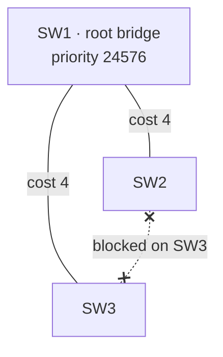
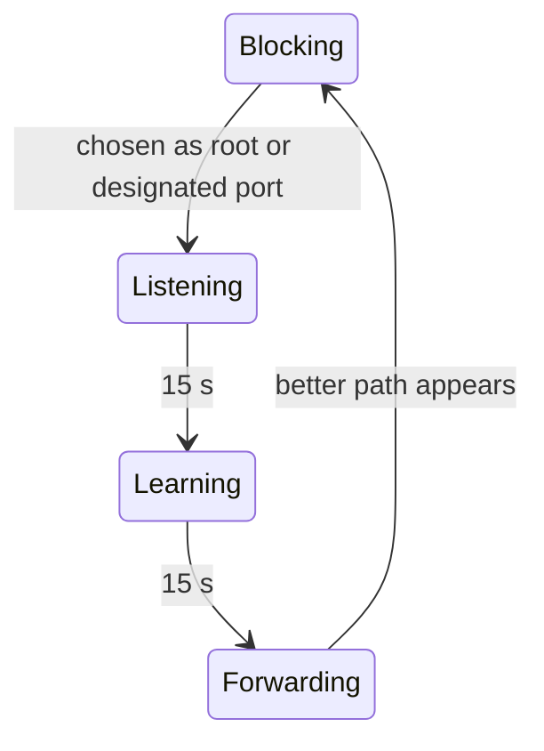

Redundant switch links create loops, and Ethernet frames have no TTL, so a broadcast would circle forever. STP elects a
**root bridge** and blocks just enough ports to turn the network into a tree. If a link fails, a blocked port takes over.



## How the tree is built

1. **Root bridge:** the switch with the lowest bridge ID (priority, then MAC address) wins. All ports on the root forward.
1. **Root port:** every other switch picks its port with the lowest total cost to the root.
1. **Designated port:** on every link, the side closer to the root forwards.
1. **Blocked:** all remaining ports discard data frames but keep listening to BPDUs.

| Link speed | Cost (short method) |
| ---------- | ------------------- |
| 10 Mbit/s  | 100                 |
| 100 Mbit/s | 19                  |
| 1 Gbit/s   | 4                   |
| 10 Gbit/s  | 2                   |

:::caution
With default priorities (32768 plus the VLAN number) the switch with the **lowest MAC** becomes root, which is usually
the oldest one. Always set the root explicitly on a core switch.
:::

## Configuration

STP is enabled by default; you only influence the result. Cisco runs one instance per VLAN (PVST+), so most commands take
a VLAN range.

```text title="Core switch"
Switch# configure terminal
Switch(config)# spanning-tree mode rapid-pvst
Switch(config)# spanning-tree vlan 1-100 root primary
Switch(config)# interface GigabitEthernet0/10
Switch(config-if)# spanning-tree portfast
Switch(config-if)# spanning-tree bpduguard enable
Switch(config-if)# end
Switch# write memory
```

| Command                                     | Effect                                                                         |
| ------------------------------------------- | ------------------------------------------------------------------------------ |
| `spanning-tree mode rapid-pvst`             | Rapid STP (802.1w): converges in about a second instead of 30–50 s.            |
| `spanning-tree vlan <range> priority <n>`   | Sets the bridge priority, a multiple of 4096. Lower wins.                      |
| `spanning-tree vlan <range> root primary`   | Sets the priority to 24576, or just below the current root if that's lower.    |
| `spanning-tree vlan <range> root secondary` | Sets 28672, so this switch takes over if the root fails.                       |
| `spanning-tree cost <n>`                    | (interface) Overrides the port cost to steer which port gets blocked.          |
| `spanning-tree portfast`                    | (interface) Forwards immediately. Only for ports to end devices.               |
| `spanning-tree bpduguard enable`            | (interface) Shuts the port down when a BPDU arrives, e.g. from a rogue switch. |

## Port states

Classic STP waits in each intermediate state for the forward delay (15 s) so that the topology has settled before a
port forwards. Rapid STP replaces the timers with a handshake between neighbors.



## Verification

| Command                                    | Shows                                                    |
| ------------------------------------------ | -------------------------------------------------------- |
| `show spanning-tree vlan <id>`             | Root bridge, own bridge ID, and role and state per port. |
| `show spanning-tree root`                  | The root bridge and root port for every VLAN.            |
| `show spanning-tree summary`               | Mode and which ports use PortFast or BPDU Guard.         |
| `show spanning-tree interface <if> detail` | BPDU counters, useful when hunting topology changes.     |
