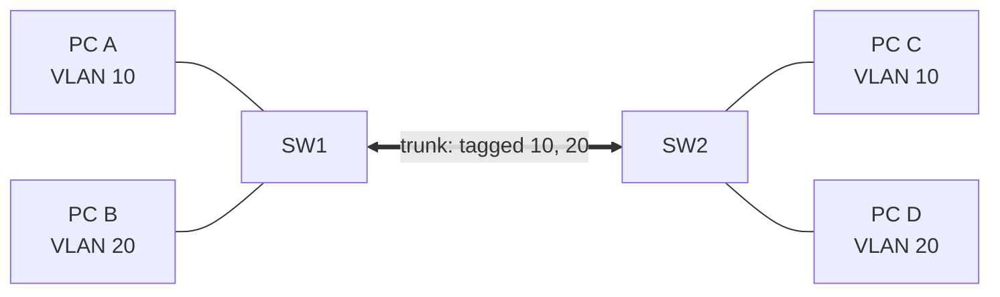

VLANs split one physical switch into several separate broadcast domains. **Access** ports belong to one VLAN and carry
untagged frames to end devices. **Trunk** ports carry several VLANs between switches and mark each frame with an 802.1Q
tag. PC A reaches PC C, but traffic between VLANs (PC A to PC B) always goes through a router or layer 3 switch.



## Configuration

```text title="Create VLANs"
Switch# configure terminal
Switch(config)# vlan 10
Switch(config-vlan)# name clients
Switch(config-vlan)# vlan 20
Switch(config-vlan)# name servers
Switch(config-vlan)# end
```

```text title="Access port"
Switch(config)# interface GigabitEthernet0/5
Switch(config-if)# switchport mode access
Switch(config-if)# switchport access vlan 10
```

```text title="Trunk port"
Switch(config)# interface GigabitEthernet0/24
Switch(config-if)# switchport trunk encapsulation dot1q
Switch(config-if)# switchport mode trunk
Switch(config-if)# switchport trunk allowed vlan 10,20
Switch(config-if)# switchport trunk native vlan 999
```

The `encapsulation` line is only needed (and only accepted) on switches that also support the old ISL protocol. Save
everything with `write memory`.

:::caution
`switchport trunk allowed vlan 30` **replaces** the list, cutting off every other VLAN on that trunk. To extend it,
use `switchport trunk allowed vlan add 30`.
:::

:::tip
Frames in the native VLAN cross the trunk untagged. Set it to an unused VLAN, identical on both sides; a mismatch merges
two VLANs and shows up as `%CDP-4-NATIVE_VLAN_MISMATCH`.
:::

## Verification

| Command                            | Shows                                                          |
| ---------------------------------- | -------------------------------------------------------------- |
| `show vlan brief`                  | All VLANs and their access ports (trunk ports are not listed). |
| `show interfaces trunk`            | Trunk ports, native VLAN and the allowed and active VLANs.     |
| `show interfaces <if> switchport`  | Mode, access VLAN and trunk settings of one port.              |
| `show mac address-table vlan <id>` | Which MAC addresses the switch learned in a VLAN.              |
