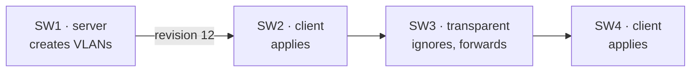

VTP (Cisco-proprietary) distributes the VLAN database over trunk links: you create a VLAN once on a server and every
switch in the same **domain** learns it. Only the VLAN list is shared; port assignments stay local.



## Modes

| Mode          | Create VLANs locally | Applies updates | Forwards updates |
| ------------- | :------------------: | :-------------: | :--------------: |
| `server`      |          ✅          |       ✅        |        ✅        |
| `client`      |                      |       ✅        |        ✅        |
| `transparent` |   ✅ (local only)    |                 |        ✅        |
| `off` (v3)    |   ✅ (local only)    |                 |                  |

## Configuration

```text
Switch# configure terminal
Switch(config)# vtp domain lab
Switch(config)# vtp version 3
Switch(config)# vtp mode server
Switch(config)# vtp password secret
Switch(config)# end
```

Domain, version and password must match on all switches. Updates only travel over trunks.

:::danger
Every change increases the **configuration revision**, and switches always adopt the database with the highest
revision. Plugging in a used switch with the same domain and a higher revision can replace, and delete, the VLANs of
the whole network. Before connecting a switch, reset its revision to 0 by setting it to `transparent` and back, or by
changing the domain name.
:::

VTP version 3 reduces this risk: only the switch promoted with `vtp primary` (privileged EXEC) can change the database.

## Verification

| Command             | Shows                                                               |
| ------------------- | ------------------------------------------------------------------- |
| `show vtp status`   | Mode, domain, version and the configuration revision.               |
| `show vtp password` | The configured password.                                            |
| `show vtp counters` | Sent and received advertisements, useful when updates don't arrive. |
