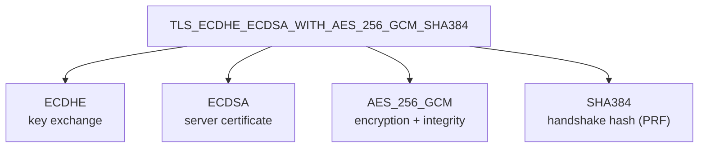
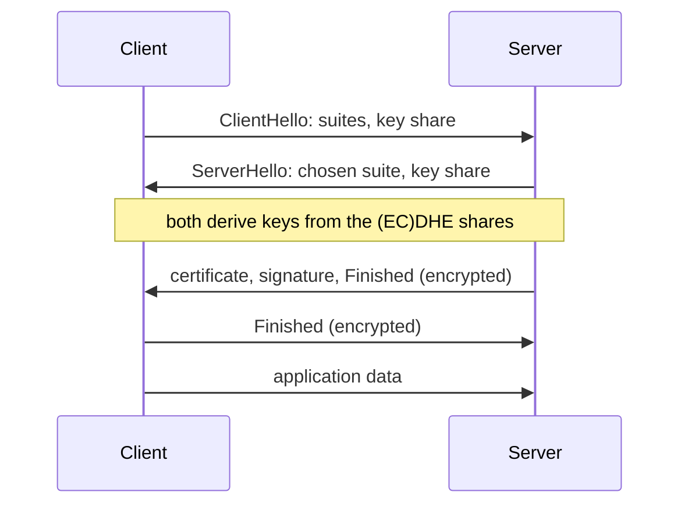

A cipher suite names the algorithms a TLS connection uses. The client offers a list in its _ClientHello_, and the server
picks one.

## Reading a TLS 1.2 suite name

| Part           | Common values              | Avoid                                 |
| -------------- | -------------------------- | ------------------------------------- |
| Key exchange   | ECDHE, DHE                 | RSA key exchange (no forward secrecy) |
| Authentication | ECDSA, RSA                 | DSA, anonymous (`anon`)               |
| Encryption     | AES-GCM, CHACHA20-POLY1305 | CBC modes, RC4, 3DES                  |
| Hash           | SHA256, SHA384             | MD5, SHA1                             |

GCM and Poly1305 already authenticate the data (AEAD), so in those suites the hash is only used for the handshake.

## TLS 1.3

TLS 1.3 removed all weak options. Key exchange is always ephemeral (EC)DHE and authentication comes from the certificate,
so the suite names only encryption and hash, e.g. `TLS_AES_256_GCM_SHA384` or `TLS_CHACHA20_POLY1305_SHA256`.

TLS 1.3 needs one round trip before data flows; TLS 1.2 needed two.

## Inspecting a server

| Command                                                | Shows                                             |
| ------------------------------------------------------ | ------------------------------------------------- |
| `openssl s_client -connect example.com:443 </dev/null` | Negotiated protocol and cipher suite.             |
| `openssl s_client -connect example.com:443 -tls1_2`    | Whether the server still accepts TLS 1.2.         |
| `nmap --script ssl-enum-ciphers -p 443 example.com`    | Every accepted suite with a grade.                |
| `openssl ciphers -v 'ECDHE+AESGCM'`                    | Which suites an OpenSSL cipher string expands to. |

The full list of registered suites is maintained by the
[IANA](https://www.iana.org/assignments/tls-parameters/tls-parameters.xhtml).
