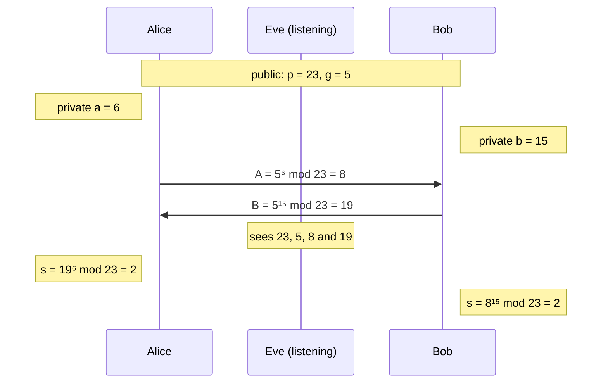

Diffie-Hellman lets two parties agree on a shared secret over a channel that anyone can read. Each side keeps a private
number, publishes a value derived from it, and combines the other side's value with its own private number. Both arrive
at the same secret; an eavesdropper only sees the public values and can't feasibly undo the exponentiation (the
discrete logarithm problem).

## Example with small numbers

Public parameters: prime `p = 23`, base `g = 5`. Real-world primes have 2048 bits or more.

Both compute `g^(a·b) mod p`, just in a different order: `(g^b)^a = (g^a)^b`.

## Variants

| Variant     | Math                                | Notes                                                                   |
| ----------- | ----------------------------------- | ----------------------------------------------------------------------- |
| DH / FFDHE  | modular exponentiation              | Needs large keys (2048+ bits) for current security levels.              |
| ECDH        | elliptic curve point multiplication | 256-bit keys (e.g. X25519) match about 3072-bit DH and are much faster. |
| DHE / ECDHE | either, with fresh keys             | **E**phemeral: new private numbers for every session.                   |

:::tip[Forward secrecy]
With ephemeral keys, the private numbers are deleted after the handshake. An attacker who records the traffic and later
steals the server's certificate key still can't compute the session keys. TLS 1.3 only allows ephemeral key exchange.
:::

:::caution
Diffie-Hellman alone doesn't prove **who** is on the other end. A man in the middle can run one exchange with Alice and
another with Bob. Protocols therefore sign the exchanged values, as TLS does with the server certificate and SSH with
the host key.
:::
