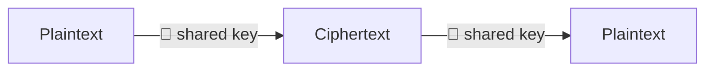
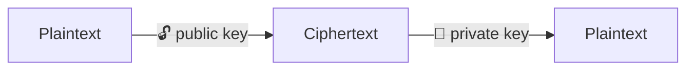
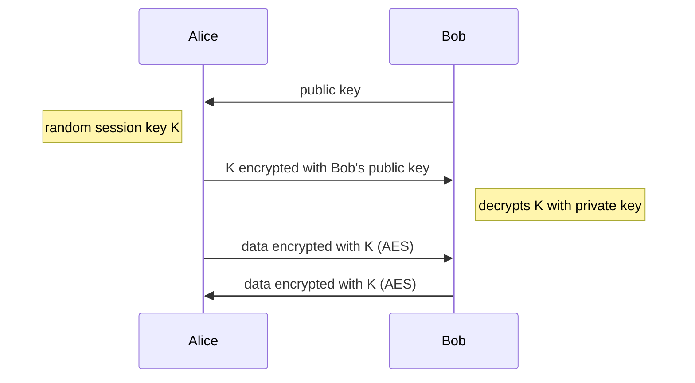

## Symmetric encryption

One secret key encrypts and decrypts. It's fast and suited for bulk data, but both parties need the same key first, and
getting it to the other side securely is the hard part.

Examples: AES, ChaCha20.

## Asymmetric encryption

Each party has a key pair. The **public key** can be shared with anyone and only encrypts; the matching **private key**
never leaves its owner and decrypts. Reversed, the private key creates **signatures** that anyone can check with the
public key.

Examples: RSA, elliptic curves (ECDSA, Ed25519 for signatures).

## Hybrid encryption

Asymmetric encryption is roughly a thousand times slower and limited in message size, so real protocols combine both:
the asymmetric part (or a [Diffie-Hellman exchange](/docs/cryptography/dh/)) agrees on a random symmetric session key,
and the data itself is encrypted symmetrically. TLS, SSH, PGP and age all work this way.

| Property         | Symmetric                  | Asymmetric                                |
| ---------------- | -------------------------- | ----------------------------------------- |
| Keys             | one shared secret          | public and private key pair               |
| Speed            | fast, hardware-accelerated | slow                                      |
| Typical key size | 128–256 bit                | 2048–4096 bit RSA, 256 bit elliptic curve |
| Used for         | bulk data                  | key exchange, signatures                  |
