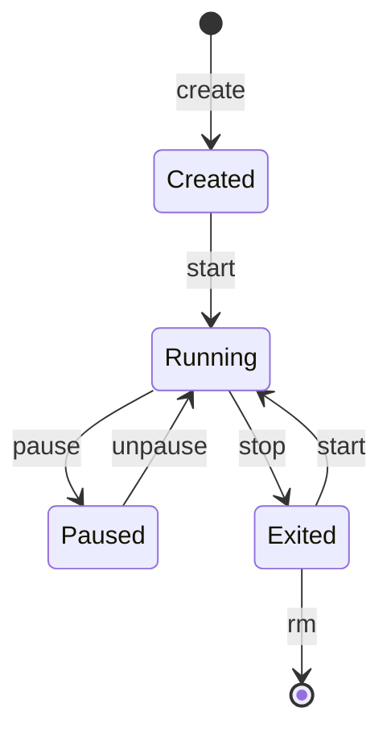

Almost all commands work the same with `podman` instead of `docker`.

`docker run` is `create` and `start` in one step.

## Running containers

| Command                                     | Effect                                                                                                                |
| ------------------------------------------- | --------------------------------------------------------------------------------------------------------------------- |
| `docker run -d --name web nginx`            | Starts a container in the background.                                                                                 |
| `docker run -it --rm alpine sh`             | Interactive shell; the container is deleted on exit.                                                                  |
| `docker run -p 8080:80 nginx`               | Publishes container port 80 on host port 8080 (`host:container`).                                                     |
| `docker run -v ./data:/data alpine`         | Mounts a host directory into the container.                                                                           |
| `docker run -v data:/data alpine`           | Mounts the named volume `data` (created if missing).                                                                  |
| `docker run -e KEY=value alpine`            | Sets an environment variable.                                                                                         |
| `docker run --restart unless-stopped nginx` | Restarts the container after crashes and reboots.                                                                     |
| `docker exec -it web sh`                    | Opens a shell in a running container.                                                                                 |
| `docker attach web`                         | Attaches to the main process; <kbd>Ctrl</kbd>+<kbd>P</kbd> <kbd>Ctrl</kbd>+<kbd>Q</kbd> detaches without stopping it. |
| `docker stop web` / `docker start web`      | Stops (SIGTERM, then SIGKILL after 10 s) or starts it again.                                                          |
| `docker pause web` / `docker unpause web`   | Freezes and resumes all processes.                                                                                    |

:::tip
Containers reach each other by name only on a user-defined network: `docker network create app`, then
`docker run --network app --name db …`. Other containers on `app` can connect to `db`. The old `--link` option is
deprecated.
:::

## Inspecting

| Command                         | Shows                                                     |
| ------------------------------- | --------------------------------------------------------- |
| `docker ps` / `docker ps -a`    | Running containers / all containers.                      |
| `docker logs -f --tail 100 web` | The last 100 log lines, then follows new output.          |
| `docker inspect web`            | Full configuration and state as JSON.                     |
| `docker stats`                  | Live CPU, memory and network usage.                       |
| `docker diff web`               | Files changed in the container compared to its image.     |
| `docker info`                   | Engine configuration, storage driver and resource counts. |

## Images

| Command                       | Effect                                                           |
| ----------------------------- | ---------------------------------------------------------------- |
| `docker pull nginx:1.27`      | Downloads an image. Without a tag, `latest` is used.             |
| `docker build -t myapp:1.0 .` | Builds an image from the `Containerfile` or `Dockerfile` in `.`. |
| `docker images`               | Lists local images.                                              |
| `docker history myapp:1.0`    | The layers of an image and their sizes.                          |
| `docker commit web myimage`   | Saves a container's current state as a new image.                |

## Cleaning up

| Command                         | Removes                                                              |
| ------------------------------- | -------------------------------------------------------------------- |
| `docker system df`              | Nothing; shows how much space can be reclaimed.                      |
| `docker container prune`        | All stopped containers.                                              |
| `docker image prune -a`         | All images not used by a container.                                  |
| `docker volume prune -a`        | All volumes not used by a container, **including their data**.       |
| `docker system prune -a`        | Stopped containers, unused networks and images, and the build cache. |
| `docker rm -f $(docker ps -aq)` | Every container, including running ones.                             |
