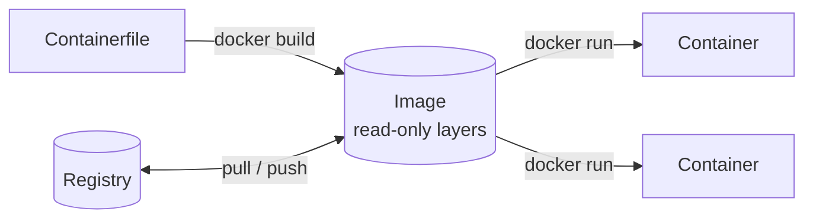

A Containerfile (Docker calls it `Dockerfile`) describes how to build an image. Every instruction adds a layer on top of
the previous one, and unchanged layers are reused from the cache on the next build.



## Instructions

| Instruction  | Effect                                                                                                               |
| ------------ | -------------------------------------------------------------------------------------------------------------------- |
| `FROM`       | Base image. Every Containerfile starts with it.                                                                      |
| `RUN`        | Runs a command at build time and stores the result as a layer.                                                       |
| `COPY`       | Copies files from the build context into the image.                                                                  |
| `ADD`        | Like `COPY`, but also unpacks local archives and downloads URLs. Prefer `COPY`.                                      |
| `WORKDIR`    | Sets the working directory for the following instructions and the container.                                         |
| `ENV`        | Sets an environment variable at build time and in the container.                                                     |
| `ARG`        | Variable only available during the build (`--build-arg NAME=value`).                                                 |
| `EXPOSE`     | Documents a port. It publishes nothing; that needs `-p` on `docker run`.                                             |
| `USER`       | User for the following instructions and the container.                                                               |
| `ENTRYPOINT` | The executable the container runs.                                                                                   |
| `CMD`        | Default arguments for the entrypoint (or the command, without an entrypoint). Replaced by arguments to `docker run`. |
| `LABEL`      | Metadata, e.g. `org.opencontainers.image.source`. Replaces the deprecated `MAINTAINER`.                              |

## ENTRYPOINT and CMD

`docker run image args` replaces `CMD` but keeps `ENTRYPOINT`:

| Containerfile                           | `docker run image` runs | `docker run image world` runs |
| --------------------------------------- | ----------------------- | ----------------------------- |
| `CMD ["echo", "hello"]`                 | `echo hello`            | `world`                       |
| `ENTRYPOINT ["echo"]` + `CMD ["hello"]` | `echo hello`            | `echo world`                  |
| `ENTRYPOINT ["echo", "hi"]`             | `echo hi`               | `echo hi world`               |

:::caution
Use the JSON form (`["executable", "arg"]`). The shell form (`CMD echo hello`) wraps the command in `/bin/sh -c`, so the
process doesn't receive `SIGTERM` on `docker stop` and is killed after 10 seconds. A shell-form `ENTRYPOINT` also
ignores `CMD` and all `docker run` arguments.
:::

## Example

```dockerfile title="Containerfile"
FROM python:3.13-slim

WORKDIR /app

# Dependencies change less often than code, so install them in their own cached layer.
COPY requirements.txt .
RUN pip install --no-cache-dir -r requirements.txt

COPY . .

RUN useradd --create-home app
USER app

EXPOSE 8000
ENTRYPOINT ["python", "-m", "gunicorn", "--bind", "0.0.0.0:8000"]
CMD ["app:app"]
```

```sh
docker build -t myapp:1.0 .
docker run -d -p 8000:8000 myapp:1.0
```

:::tip
Add a `.dockerignore` (or `.containerignore`) with entries like `.git` and `.venv`. It keeps them out of the build
context, which makes builds faster and prevents `COPY . .` from invalidating the cache on unrelated changes.
:::
