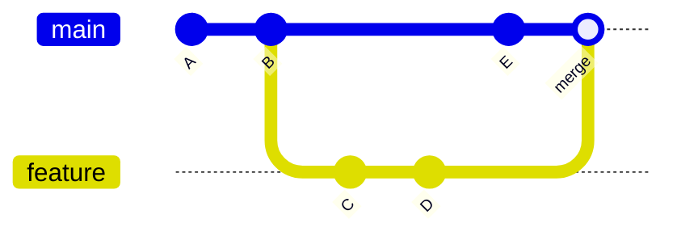
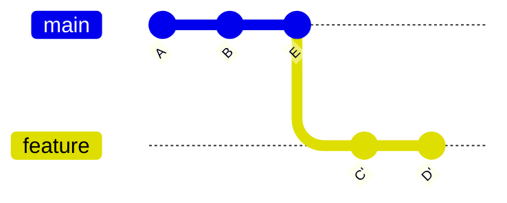
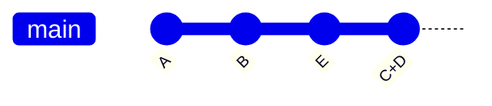

A branch is just a movable pointer to a commit. Committing moves the checked-out branch forward, so work on separate
branches doesn't interfere until you combine it.

## Working with branches

| Command                            | Effect                                                                                 |
| ---------------------------------- | -------------------------------------------------------------------------------------- |
| `git switch -c develop`            | Creates `develop` at the current commit and switches to it.                            |
| `git switch main`                  | Switches to an existing branch.                                                        |
| `git switch -`                     | Switches back to the previous branch.                                                  |
| `git branch -a`                    | Lists local and remote-tracking branches.                                              |
| `git branch -vv`                   | Shows which remote branch each local branch tracks, and how far ahead or behind it is. |
| `git branch -m old new`            | Renames a branch.                                                                      |
| `git branch -d develop`            | Deletes a branch that is merged.                                                       |
| `git branch -D develop`            | Deletes a branch even if it isn't merged.                                              |
| `git push origin --delete develop` | Deletes the branch on the remote.                                                      |

`git checkout <branch>` and `git checkout -b <branch>` still work; `switch` is the newer command that only handles
branches.

## Combining branches

All three ways end with the changes of `feature` on `main`; they differ in what the history looks like.

### Merge

Keeps both lines of history and joins them with a merge commit.



```sh
git switch main
git merge feature
```

### Rebase

Replays the feature commits on top of `main` as new commits (`C'`, `D'`), giving a straight line. `main` can then
fast-forward without a merge commit.



```sh
git switch feature
git rebase main
git switch main
git merge --ff-only feature
```

### Squash merge

Combines all feature commits into a single new commit on `main`.



```sh
git switch main
git merge --squash feature
git commit
```

:::tip
After a squash merge, `git branch -d feature` refuses because the original commits aren't on `main`. Use `-D` once you
have checked that the changes landed.
:::
