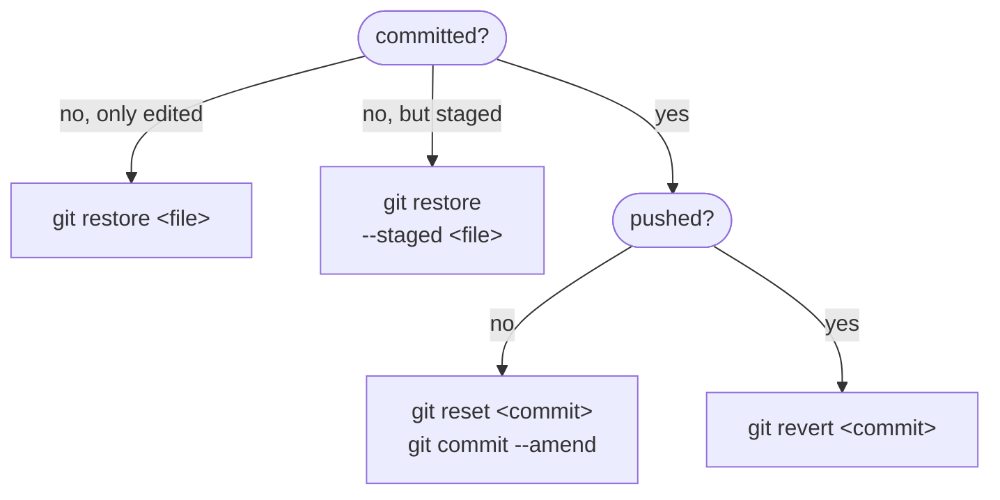

## Inspecting

| Command                                | Shows                                                    |
| -------------------------------------- | -------------------------------------------------------- |
| `git status -sb`                       | Short status with the branch and its ahead/behind count. |
| `git log --oneline --graph --all`      | The whole history as a compact graph.                    |
| `git show <commit>`                    | Message and diff of one commit.                          |
| `git diff`                             | Unstaged changes.                                        |
| `git diff --staged`                    | Staged changes, i.e. what the next commit contains.      |
| `git diff main..feature`               | Difference between two branches.                         |
| `git diff --name-status main..feature` | Only the changed file names and their status.            |
| `git log -p -- <file>`                 | Every change to one file.                                |
| `git blame <file>`                     | Which commit last changed each line.                     |

## Undoing changes

Which command you need depends on how far the change has traveled:

`git revert` adds a new commit that undoes an old one, so it's safe on shared branches. `git reset` moves the branch
pointer back and drops the commits after it from the branch:

| `git reset` mode    | Branch pointer | Index | Working tree | Use case                                    |
| ------------------- | :------------: | :---: | :----------: | ------------------------------------------- |
| `--soft`            |     moved      | kept  |     kept     | Combine the last commits into one.          |
| `--mixed` (default) |     moved      | reset |     kept     | Undo commits but keep the changes unstaged. |
| `--hard`            |     moved      | reset |    reset     | Throw everything away.                      |

:::danger
`git reset --hard` and `git restore` delete uncommitted changes without a way back. Run `git stash` first if you are
unsure.
:::

:::tip
Commits are hardly ever lost. `git reflog` lists every position `HEAD` had, including commits removed by a reset or a
failed rebase; `git reset --hard <entry>` returns there.
:::

## Common recipes

| Task                                          | Command                                                                           |
| --------------------------------------------- | --------------------------------------------------------------------------------- |
| Fix the message or content of the last commit | `git commit --amend`                                                              |
| Make the branch identical to the remote       | `git fetch origin && git reset --hard origin/main`                                |
| Park unfinished work                          | `git stash`, later `git stash pop`                                                |
| Take a single commit from another branch      | `git cherry-pick <commit>`                                                        |
| Delete untracked files (preview first)        | `git clean -n`, then `git clean -fd`                                              |
| Find the commit that introduced a bug         | `git bisect start`, `git bisect bad`, `git bisect good <commit>`                  |
| Make another branch the new `main`            | `git switch main && git reset --hard feature`, then `git push --force-with-lease` |
