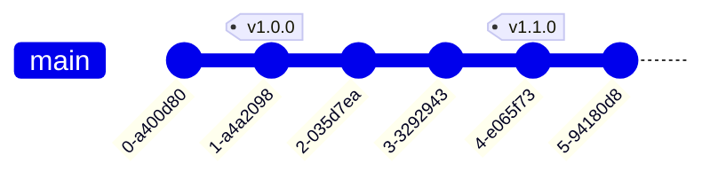

A tag is a fixed name for a commit, usually a release such as `v1.0.0`. Unlike a branch, it never moves.

| Command                                | Effect                                                                     |
| -------------------------------------- | -------------------------------------------------------------------------- |
| `git tag -a v1.0.0 -m "Release 1.0.0"` | Annotated tag on `HEAD`, with author, date and message.                    |
| `git tag -a v1.0.0 <commit>`           | Tags an older commit.                                                      |
| `git tag v1.0.0`                       | Lightweight tag: just a name, no metadata.                                 |
| `git tag -l 'v1.*'`                    | Lists matching tags.                                                       |
| `git show v1.0.0`                      | Tag details and the tagged commit.                                         |
| `git describe --tags`                  | The latest tag plus the number of commits since, e.g. `v1.1.0-3-gabc1234`. |
| `git push origin v1.0.0`               | Publishes one tag.                                                         |
| `git push --follow-tags`               | Pushes commits together with the annotated tags that point to them.        |
| `git tag -d v1.0.0`                    | Deletes a tag locally.                                                     |
| `git push origin --delete v1.0.0`      | Deletes a tag on the remote.                                               |

:::caution
`git push` doesn't send tags. Push them explicitly or with `--follow-tags`.
:::

:::tip
Use annotated tags for releases: `git describe` and `--follow-tags` ignore lightweight tags by default, and only annotated
tags can be signed (`git tag -s`).
:::
