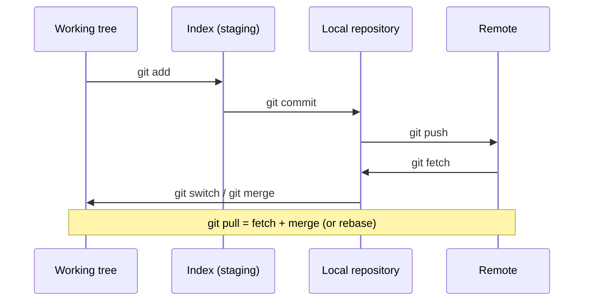

A change moves through four places. Only the last one is shared with others; everything before `push` can still be
rewritten freely.



| Place            | Contains                                                | Inspect with                |
| ---------------- | ------------------------------------------------------- | --------------------------- |
| Working tree     | The files you edit.                                     | `git status`, `git diff`    |
| Index            | The snapshot the next commit will contain.              | `git diff --staged`         |
| Local repository | All commits; `HEAD` points to the checked-out one.      | `git log --oneline --graph` |
| Remote           | The shared copy, mirrored locally as `origin/<branch>`. | `git log origin/main`       |

## Feature branch workflow

```sh
git switch -c feature/login        # new branch from the current one
git add -p                         # stage changes hunk by hunk
git commit -m "Add login form"
git push -u origin feature/login   # -u: later pushes need no arguments
```

Then open a pull request, or merge locally:

```sh
git switch main
git pull
git merge feature/login
git push
git branch -d feature/login
```

:::tip
`git add -p` shows every change and asks whether to stage it. It catches leftover debug code and lets one messy working
tree become several focused commits.
:::

:::caution
Only rewrite history (`rebase`, `commit --amend`, `reset`) of commits that you haven't pushed, or that only you use.
Otherwise everyone else's branches diverge from yours. If you must push rewritten history, use
`git push --force-with-lease`, which refuses when someone else pushed in the meantime.
:::
