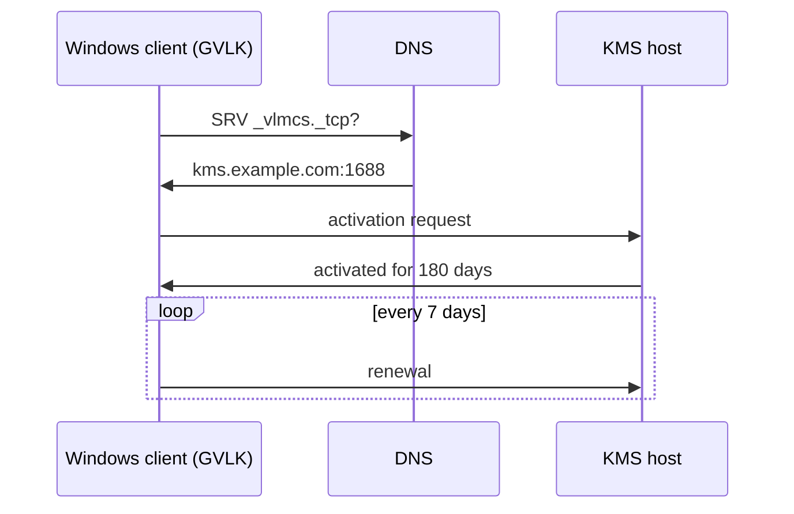

Volume-licensed Windows activates against a **KMS host** in the local network. Clients find it via the DNS record
`_vlmcs._tcp` and need the generic volume license key (GVLK) of their edition, listed below. These keys only work
against a KMS host; they don't activate Windows on their own.

A KMS host only activates Windows clients once at least 25 machines have asked (5 for Windows Server).

## Activation commands

Run in an administrator command prompt:

| Command                       | Effect                                            |
| ----------------------------- | ------------------------------------------------- |
| `slmgr /ipk <GVLK>`           | Installs the key.                                 |
| `slmgr /skms kms.example.com` | Sets the KMS host instead of using DNS discovery. |
| `slmgr /ato`                  | Activates now.                                    |
| `slmgr /dlv`                  | Shows license, KMS host and remaining time.       |
| `slmgr /xpr`                  | Shows when the activation expires.                |

Source: [KMS client activation keys](https://learn.microsoft.com/en-us/windows-server/get-started/kms-client-activation-keys)

## Windows 10/11

| Edition                              | GVLK                          |
| ------------------------------------ | ----------------------------- |
| Windows 10/11 Pro                    | W269N-WFGWX-YVC9B-4J6C9-T83GX |
| Windows 10/11 Pro N                  | MH37W-N47XK-V7XM9-C7227-GCQG9 |
| Windows 10/11 Pro for Workstations   | NRG8B-VKK3Q-CXVCJ-9G2XF-6Q84J |
| Windows 10/11 Pro for Workstations N | 9FNHH-K3HBT-3W4TD-6383H-6XYWF |
| Windows 10/11 Pro Education          | 6TP4R-GNPTD-KYYHQ-7B7DP-J447Y |
| Windows 10/11 Pro Education N        | YVWGF-BXNMC-HTQYQ-CPQ99-66QFC |
| Windows 10/11 Education              | NW6C2-QMPVW-D7KKK-3GKT6-VCFB2 |
| Windows 10/11 Education N            | 2WH4N-8QGBV-H22JP-CT43Q-MDWWJ |
| Windows 10/11 Enterprise             | NPPR9-FWDCX-D2C8J-H872K-2YT43 |
| Windows 10/11 Enterprise N           | DPH2V-TTNVB-4X9Q3-TJR4H-KHJW4 |
| Windows 10/11 Enterprise G           | YYVX9-NTFWV-6MDM3-9PT4T-4M68B |
| Windows 10/11 Enterprise G N         | 44RPN-FTY23-9VTTB-MP9BX-T84FV |

## Windows LTSC

| Edition                                                        | GVLK                          |
| -------------------------------------------------------------- | ----------------------------- |
| Windows 11 Enterprise LTSC 2024, Windows 10 LTSC 2021/2019     | M7XTQ-FN8P6-TTKYV-9D4CC-J462D |
| Windows 11 Enterprise N LTSC 2024, Windows 10 N LTSC 2021/2019 | 92NFX-8DJQP-P6BBQ-THF9C-7CG2H |
| Windows IoT Enterprise LTSC 2024/2021                          | KBN8V-HFGQ4-MGXVD-347P6-PDQGT |

## Windows Server

| Edition                        | GVLK                          |
| ------------------------------ | ----------------------------- |
| Windows Server 2025 Standard   | TVRH6-WHNXV-R9WG3-9XRFY-MY832 |
| Windows Server 2025 Datacenter | D764K-2NDRG-47T6Q-P8T8W-YP6DF |
| Windows Server 2022 Standard   | VDYBN-27WPP-V4HQT-9VMD4-VMK7H |
| Windows Server 2022 Datacenter | WX4NM-KYWYW-QJJR4-XV3QB-6VM33 |
| Windows Server 2019 Standard   | N69G4-B89J2-4G8F4-WWYCC-J464C |
| Windows Server 2019 Datacenter | WMDGN-G9PQG-XVVXX-R3X43-63DFG |

## Older versions

| Edition                  | GVLK                          |
| ------------------------ | ----------------------------- |
| Windows 8.1 Pro          | GCRJD-8NW9H-F2CDX-CCM8D-9D6T9 |
| Windows 8.1 Pro N        | HMCNV-VVBFX-7HMBH-CTY9B-B4FXY |
| Windows 8.1 Enterprise   | MHF9N-XY6XB-WVXMC-BTDCT-MKKG7 |
| Windows 8.1 Enterprise N | TT4HM-HN7YT-62K67-RGRQJ-JFFXW |
| Windows 8 Pro            | NG4HW-VH26C-733KW-K6F98-J8CK4 |
| Windows 8 Pro N          | XCVCF-2NXM9-723PB-MHCB7-2RYQQ |
| Windows 8 Enterprise     | 32JNW-9KQ84-P47T8-D8GGY-CWCK7 |
| Windows 8 Enterprise N   | JMNMF-RHW7P-DMY6X-RF3DR-X2BQT |
| Windows 7 Professional   | FJ82H-XT6CR-J8D7P-XQJJ2-GPDD4 |
| Windows 7 Professional N | MRPKT-YTG23-K7D7T-X2JMM-QY7MG |
| Windows 7 Professional E | W82YF-2Q76Y-63HXB-FGJG9-GF7QX |
| Windows 7 Enterprise     | 33PXH-7Y6KF-2VJC9-XBBR8-HVTHH |
| Windows 7 Enterprise N   | YDRBP-3D83W-TY26F-D46B2-XCKRJ |
| Windows 7 Enterprise E   | C29WB-22CC8-VJ326-GHFJW-H9DH4 |
