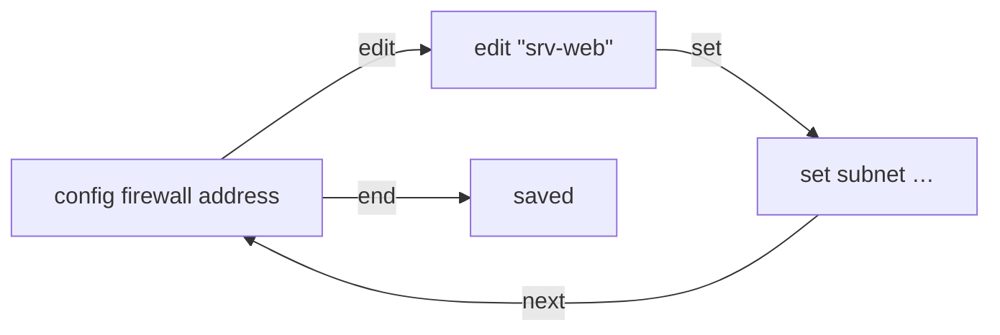
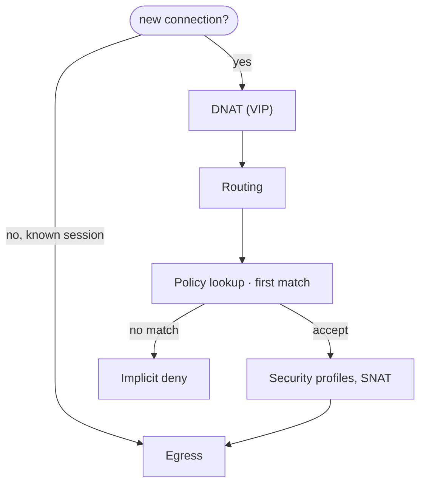

## CLI basics

FortiOS configuration is a tree of tables. You open a table with `config`, select or create an entry with `edit`,
change its settings with `set`, and go back up with `next` (save the entry) and `end` (save and leave the table).



| Command                                          | Effect                                                                 |
| ------------------------------------------------ | ---------------------------------------------------------------------- |
| `show firewall policy`                           | Settings that differ from the defaults.                                |
| `show full-configuration system interface port1` | All settings, including defaults.                                      |
| `get system interface physical`                  | Current state (link, speed, IP) instead of configuration.              |
| `show firewall policy \| grep -f 10.0.20.10`     | Whole configuration blocks that contain the pattern.                   |
| `abort`                                          | Discards the changes in the current `config` block.                    |
| `append allowaccess ssh`                         | Adds to a list; `set` replaces the whole list.                         |
| `unselect allowaccess http`                      | Removes one entry from a list.                                         |
| `edit 0`                                         | In numbered tables (policies, routes, DHCP), creates the next free ID. |
| `tree firewall policy`                           | All available settings below a branch.                                 |
| `get system status`                              | Model, firmware, serial number and whether VDOMs are enabled.          |

:::caution
`set allowaccess ssh` on an interface you're connected through over HTTPS removes HTTPS access and locks you out of the
GUI. Use `append` to add to lists.
:::

With VDOMs enabled, run `config vdom` + `edit root` first for per-VDOM settings, or `config global` for system-wide
ones.

## Packet flow

Simplified order in which FortiOS handles a new connection. Port forwarding (VIP) happens **before** routing and the
policy lookup, which is why policies for forwarded ports use the VIP as destination.



## Interfaces and VLANs

VLAN interfaces sit on the physical port that is connected to the switch's tagged uplink (see
[Switch VLANs](/docs/networkdevices/switches/)).

```text
config system interface
    edit "vlan10"
        set interface "port2"
        set vlanid 10
        set ip 192.168.10.1 255.255.255.0
        set allowaccess ping https ssh
        set role lan
    next
end
```

```text title="DHCP server for VLAN 10"
config system dhcp server
    edit 0
        set interface "vlan10"
        set default-gateway 192.168.10.1
        set netmask 255.255.255.0
        set dns-service default
        config ip-range
            edit 1
                set start-ip 192.168.10.100
                set end-ip 192.168.10.199
            next
        end
    next
end
```

## Objects

Policies refer to address and service objects by name, and an object that is in use can't be deleted.

```text
config firewall address
    edit "srv-web"
        set subnet 10.0.20.10 255.255.255.255
    next
    edit "example.com"
        set type fqdn
        set fqdn "example.com"
    next
end
config firewall addrgrp
    edit "servers"
        set member "srv-web" "srv-db"
    next
end
config firewall service custom
    edit "tcp-8443"
        set tcp-portrange 8443
    next
end
```

## Firewall policies

Policies are checked top to bottom, the first match wins, and anything without a match is dropped by the implicit deny
policy (ID 0). The order in the list matters, not the ID.

```text title="Internet access for VLAN 10"
config firewall policy
    edit 0
        set name "vlan10-to-internet"
        set srcintf "vlan10"
        set dstintf "wan1"
        set srcaddr "all"
        set dstaddr "all"
        set service "ALL"
        set schedule "always"
        set action accept
        set nat enable
        set logtraffic all
    next
end
```

| Command                                                                     | Effect                                                                                 |
| --------------------------------------------------------------------------- | -------------------------------------------------------------------------------------- |
| `move 7 before 2`                                                           | (in `config firewall policy`) Changes the order.                                       |
| `set status disable`                                                        | Disables a policy without deleting it.                                                 |
| `set ssl-ssh-profile "certificate-inspection"`                              | Enables security profiles together with `set av-profile`, `set webfilter-profile` etc. |
| `diagnose firewall iprope lookup 192.168.10.5 50000 1.1.1.1 443 tcp vlan10` | Shows which policy would match a connection.                                           |

## Port forwarding (VIP)

```text
config firewall vip
    edit "web-443"
        set extintf "wan1"
        set extip 203.0.113.10
        set mappedip "10.0.20.10"
        set portforward enable
        set extport 443
        set mappedport 443
    next
end
config firewall policy
    edit 0
        set name "web-in"
        set srcintf "wan1"
        set dstintf "vlan20"
        set srcaddr "all"
        set dstaddr "web-443"
        set service "HTTPS"
        set schedule "always"
        set action accept
    next
end
```

## Routing

```text
config router static
    edit 0
        set gateway 203.0.113.1
        set device "wan1"
    next
end
```

Without `set dst`, the route is the default route. `get router info routing-table all` shows the active routes, and
`get router info routing-table details 1.1.1.1` which route a destination uses.

## Troubleshooting

| Command                                                                 | Shows                                                            |
| ----------------------------------------------------------------------- | ---------------------------------------------------------------- |
| `execute ping-options source 192.168.10.1` + `execute ping 1.1.1.1`     | Ping from a specific interface address.                          |
| `execute traceroute 1.1.1.1`                                            | The path to a destination.                                       |
| `get system arp`                                                        | The ARP table.                                                   |
| `diagnose sniffer packet any 'host 192.168.10.5 and icmp' 4`            | Captured packets with the interface they pass (verbosity 4).     |
| `diagnose sys session filter dst 1.1.1.1` + `diagnose sys session list` | Matching sessions with their policy and NAT.                     |
| `diagnose sys session clear`                                            | Clears the filtered sessions; **all** sessions without a filter. |

The debug flow shows the decision for every packet: route lookup, matched policy, NAT, or why it was dropped.

```text title="Debug flow"
diagnose debug reset
diagnose debug flow filter addr 192.168.10.5
diagnose debug flow show function-name enable
diagnose debug console timestamp enable
diagnose debug flow trace start 20
diagnose debug enable
# reproduce the traffic, then:
diagnose debug disable
```

Typical messages: `Denied by forward policy check (policy 0)` means no policy matched; `reverse path check fail` means
the route back to the source points to another interface.

## Administration

| Command                                             | Effect                                    |
| --------------------------------------------------- | ----------------------------------------- |
| `execute backup config tftp fgt.conf 192.168.10.5`  | Saves the configuration to a TFTP server. |
| `execute restore config tftp fgt.conf 192.168.10.5` | Restores it and reboots.                  |
| `execute reboot`                                    | Reboots.                                  |
| `execute factoryreset`                              | Resets everything except the firmware.    |

References: [FortiOS CLI reference](https://docs.fortinet.com/document/fortigate/7.6.6/cli-reference),
[FortiOS administration guide](https://docs.fortinet.com/document/fortigate/7.6.6/administration-guide),
[Using the debug flow tool](https://docs.fortinet.com/document/fortigate/7.6.6/administration-guide/38044/using-the-debug-flow-tool).
