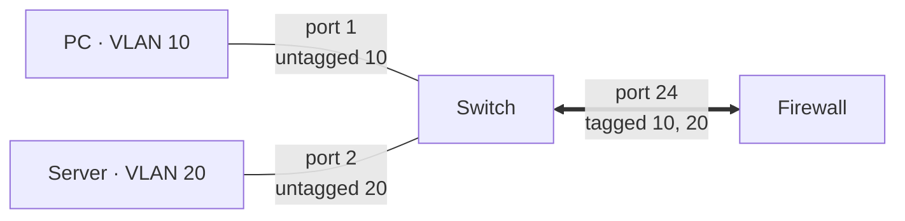
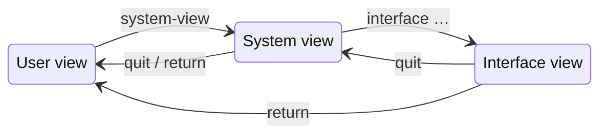

The same setup on three vendors: VLAN 10 untagged on an access port, VLAN 20 on a second one, and both VLANs tagged on
an uplink to a router or firewall (e.g. a [FortiGate](/docs/networkdevices/fortigate/)). For the concepts and the
Cisco commands, see [VLAN](/docs/cisco/vlan/).



## Command comparison

| Task                       | TP-Link JetStream                                                    | HP ArubaOS-Switch               | Huawei VRP                         |
| -------------------------- | -------------------------------------------------------------------- | ------------------------------- | ---------------------------------- |
| Configuration mode         | `configure`                                                          | `configure`                     | `system-view`                      |
| Create VLAN                | `vlan 10`                                                            | `vlan 10`                       | `vlan 10` or `vlan batch 10 20`    |
| Untagged (access) port     | `switchport general allowed vlan 10 untagged` + `switchport pvid 10` | `untagged 1` (in VLAN 10)       | `port default vlan 10`             |
| Tagged (trunk) port        | `switchport general allowed vlan 10,20 tagged`                       | `tagged 24` (in VLAN 10 and 20) | `port trunk allow-pass vlan 10 20` |
| Show VLANs                 | `show vlan brief`                                                    | `show vlans`                    | `display vlan`                     |
| Show configuration         | `show running-config`                                                | `show running-config`           | `display current-configuration`    |
| Remove a setting           | `no …`                                                               | `no …`                          | `undo …`                           |
| Save                       | `copy running-config startup-config`                                 | `write memory`                  | `save`                             |
| Link aggregation is called | LAG (`port-channel`)                                                 | **trunk** (`trk1`)              | Eth-Trunk                          |

## TP-Link (JetStream / Omada)

TP-Link's CLI looks like Cisco's, but ports use the _general_ mode: each VLAN on a port is either tagged or untagged,
and the PVID (the VLAN for incoming untagged frames) is set separately.

```text title="TP-Link"
Switch> enable
Switch# configure
Switch(config)# vlan 10
Switch(config-vlan)# name clients
Switch(config-vlan)# exit
Switch(config)# vlan 20
Switch(config-vlan)# name servers
Switch(config-vlan)# exit
Switch(config)# interface gigabitEthernet 1/0/1
Switch(config-if)# switchport general allowed vlan 10 untagged
Switch(config-if)# switchport pvid 10
Switch(config-if)# no switchport general allowed vlan 1
Switch(config-if)# exit
Switch(config)# interface gigabitEthernet 1/0/24
Switch(config-if)# switchport general allowed vlan 10,20 tagged
Switch(config-if)# end
Switch# copy running-config startup-config
```

| Command                                                       | Effect                              |
| ------------------------------------------------------------- | ----------------------------------- |
| `interface range gigabitEthernet 1/0/1-8`                     | Configures several ports at once.   |
| `show interface switchport gigabitEthernet 1/0/1`             | VLAN membership and PVID of a port. |
| `interface vlan 10` + `ip address 192.168.10.2 255.255.255.0` | Management IP in VLAN 10.           |

:::caution
Untagged membership and PVID are independent. Set both, and remove VLAN 1 from access ports, otherwise the port sends
VLAN 10 but puts incoming traffic into VLAN 1.
:::

Reference: [Typical CLI configuration examples for TP-Link JetStream switches](https://support.omadanetworks.com/us/document/13117/).
The full CLI reference guide is on the download page of each switch model.

## HP (ArubaOS-Switch / ProCurve)

ArubaOS-Switch configures VLANs **per VLAN**, not per port: inside a VLAN you list its untagged and tagged ports. A port
can be untagged in exactly one VLAN, so making it untagged in VLAN 10 removes it from VLAN 1.

```text title="HP ArubaOS-Switch"
switch# configure
switch(config)# vlan 10
switch(vlan-10)# name "clients"
switch(vlan-10)# untagged 1
switch(vlan-10)# tagged 24
switch(vlan-10)# exit
switch(config)# vlan 20
switch(vlan-20)# name "servers"
switch(vlan-20)# untagged 2
switch(vlan-20)# tagged 24
switch(vlan-20)# exit
switch(config)# write memory
```

| Command                                  | Effect                                                                   |
| ---------------------------------------- | ------------------------------------------------------------------------ |
| `untagged 1-8,10`                        | (in a VLAN) Port lists and ranges work everywhere.                       |
| `vlan 1` + `no untagged 24`              | Removes the default VLAN from the uplink (it stays tagged in 10 and 20). |
| `show vlans ports 24 detail`             | All VLANs of a port and whether they are tagged.                         |
| `vlan 10` + `ip address 192.168.10.2/24` | Management IP in VLAN 10.                                                |
| `ip default-gateway 192.168.10.1`        | Default gateway for management.                                          |
| `trunk 23-24 trk1 lacp`                  | Bundles ports 23–24 with LACP; then use `trk1` in VLAN port lists.       |

:::note
HP's "trunk" means link aggregation, not a tagged port. Newer HPE switches with **Comware** (FlexNetwork, OfficeConnect
1950\) use a syntax almost identical to Huawei's below, and **AOS-CX** switches use a Cisco-like syntax
(`vlan access 10`, `vlan trunk allowed 10,20`).
:::

Reference: [AOS-S documentation portal](https://arubanetworking.hpe.com/techdocs/AOS-S/DocPortal/Content/home.htm)
(Management and Configuration Guide and Advanced Traffic Management Guide for VLANs).

## Huawei (VRP)

Huawei uses _views_ instead of modes, `quit` to go one level up, `return` to leave the system view, and `undo` to remove
settings. The prompt shows the view: `<HUAWEI>` is the user view, `[HUAWEI]` the system view.



```text title="Huawei"
<HUAWEI> system-view
[HUAWEI] vlan batch 10 20
[HUAWEI] interface GigabitEthernet0/0/1
[HUAWEI-GigabitEthernet0/0/1] port link-type access
[HUAWEI-GigabitEthernet0/0/1] port default vlan 10
[HUAWEI-GigabitEthernet0/0/1] quit
[HUAWEI] interface GigabitEthernet0/0/24
[HUAWEI-GigabitEthernet0/0/24] port link-type trunk
[HUAWEI-GigabitEthernet0/0/24] port trunk allow-pass vlan 10 20
[HUAWEI-GigabitEthernet0/0/24] undo port trunk allow-pass vlan 1
[HUAWEI-GigabitEthernet0/0/24] return
<HUAWEI> save
```

For one untagged and several tagged VLANs on the same port (e.g. a PC behind an IP phone), use a **hybrid** port:

```text title="Hybrid port"
[HUAWEI-GigabitEthernet0/0/5] port link-type hybrid
[HUAWEI-GigabitEthernet0/0/5] port hybrid pvid vlan 10
[HUAWEI-GigabitEthernet0/0/5] port hybrid untagged vlan 10
[HUAWEI-GigabitEthernet0/0/5] port hybrid tagged vlan 20
```

| Command                                                                | Effect                                          |
| ---------------------------------------------------------------------- | ----------------------------------------------- |
| `vlan 10` + `description clients`                                      | Names a VLAN.                                   |
| `port-group group-member GigabitEthernet0/0/1 to GigabitEthernet0/0/8` | Configures several ports at once.               |
| `display port vlan`                                                    | Link type, PVID and allowed VLANs of all ports. |
| `display this`                                                         | The configuration of the current view.          |
| `interface Vlanif10` + `ip address 192.168.10.2 24`                    | Management IP in VLAN 10.                       |
| `ip route-static 0.0.0.0 0 192.168.10.1`                               | Default route.                                  |

:::tip
VRP refuses to change the link type while VLAN settings of the old type exist. Remove them first, e.g.
`undo port trunk allow-pass vlan 10 20` before switching a trunk to access. CloudEngine models also need `commit` after
changes before they take effect.
:::

Reference: [Huawei S series configuration guide: VLAN](https://support.huawei.com/enterprise/en/doc/EDOC1000178168/10db067f/vlan-configuration).
