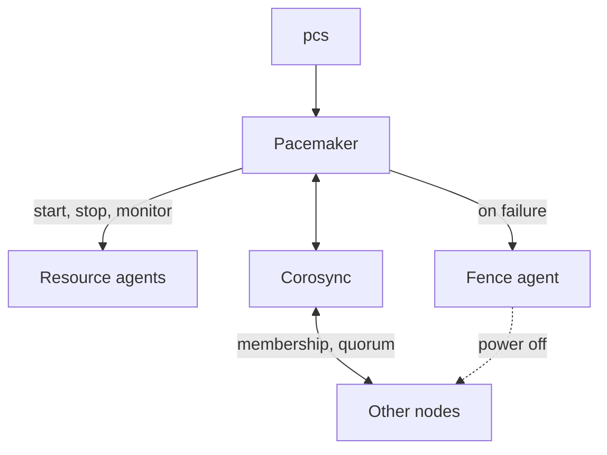

Corosync handles membership and quorum, Pacemaker decides where resources run, and resource agents start, stop and
monitor the actual services. `pcs` configures all of it.

Commands below are for `pcs` 0.11 (RHEL 9 and later). Older versions use `show` instead of `config` and `pcs cluster standby` instead of `pcs node standby`.

## Status

| Command              | Shows                                                                             |
| -------------------- | --------------------------------------------------------------------------------- |
| `pcs status`         | Nodes, resources, failed actions and daemon status.                               |
| `pcs status --full`  | Additionally node attributes and fail counts.                                     |
| `pcs cluster status` | Only nodes and the pcsd daemons.                                                  |
| `pcs status nodes`   | Which nodes are online, standby or offline.                                       |
| `crm_mon`            | Live view that refreshes; `crm_mon -1r` prints once, including stopped resources. |
| `pcs config`         | The complete configuration.                                                       |
| `pcs cluster cib`    | The raw CIB (cluster information base) as XML.                                    |

## Cluster and nodes

| Command                     | Effect                                                                        |
| --------------------------- | ----------------------------------------------------------------------------- |
| `pcs cluster start --all`   | Starts Corosync and Pacemaker on all nodes (omit `--all` for the local node). |
| `pcs cluster stop --all`    | Stops the cluster on all nodes.                                               |
| `pcs cluster enable --all`  | Starts the cluster at boot.                                                   |
| `pcs node standby <node>`   | Moves all resources off the node, e.g. for maintenance.                       |
| `pcs node unstandby <node>` | Allows resources on the node again.                                           |
| `pcs cluster sync`          | Copies `corosync.conf` to all nodes.                                          |
| `pcs cluster corosync`      | Prints `corosync.conf`.                                                       |
| `pcs cluster destroy`       | Removes the cluster configuration from the node. Irreversible.                |

## Resources

| Command                                                                      | Effect                                                   |
| ---------------------------------------------------------------------------- | -------------------------------------------------------- |
| `pcs resource list`                                                          | Available resource agents.                               |
| `pcs resource describe ocf:heartbeat:IPaddr2`                                | Options of an agent.                                     |
| `pcs resource create vip ocf:heartbeat:IPaddr2 ip=10.0.0.10 cidr_netmask=24` | Creates a resource.                                      |
| `pcs resource config [<resource>]`                                           | Configuration of one or all resources.                   |
| `pcs resource update <resource> <option>=<value>`                            | Changes options.                                         |
| `pcs resource enable` / `disable <resource>`                                 | Starts or stops a resource, cluster-wide.                |
| `pcs resource restart <resource>`                                            | Restarts it where it runs.                               |
| `pcs resource move <resource> <node>`                                        | Moves it to another node.                                |
| `pcs resource cleanup <resource>`                                            | Clears failures so Pacemaker tries again.                |
| `pcs resource debug-start <resource> --full`                                 | Runs the agent outside the cluster and shows its output. |
| `pcs resource group list`                                                    | Resource groups and their members.                       |
| `pcs resource delete <resource>`                                             | Deletes a resource.                                      |
| `pcs resource defaults update resource-stickiness=100`                       | Makes resources prefer to stay where they are.           |
| `pcs constraint config`                                                      | Location, order and colocation constraints.              |

:::caution
Before `pcs` 0.11, `pcs resource move` worked by adding a location constraint that stayed after the move and pinned the
resource to that node. Remove it with `pcs resource clear <resource>`. Newer versions remove it automatically.
:::

## Fencing

| Command                                       | Effect                            |
| --------------------------------------------- | --------------------------------- |
| `pcs stonith list`                            | Available fence agents.           |
| `pcs stonith describe <agent>`                | Options of a fence agent.         |
| `pcs stonith create <name> <agent> <options>` | Creates a fence device.           |
| `pcs stonith config`                          | Configured fence devices.         |
| `pcs stonith update <name> <options>`         | Changes a fence device.           |
| `pcs stonith fence <node>`                    | Fences a node, to test the setup. |
| `pcs stonith cleanup`                         | Clears fencing failures.          |
| `pcs stonith delete <name>`                   | Deletes a fence device.           |

## Cluster properties

| Command                                    | Effect                                       |
| ------------------------------------------ | -------------------------------------------- |
| `pcs property config --all`                | All properties including defaults.           |
| `pcs property set stonith-enabled=false`   | Runs without fencing.                        |
| `pcs property set no-quorum-policy=ignore` | Keeps running resources when quorum is lost. |

:::danger
Disabling fencing or ignoring quorum is only acceptable in test setups. Without them, both halves of a split cluster can
start the same resources and, for example, mount and corrupt the same filesystem. For two-node clusters, Corosync's
`two_node: 1` (set automatically by `pcs`) is the safe way to keep quorum.
:::

## Files

| Path                               | Content                                                       |
| ---------------------------------- | ------------------------------------------------------------- |
| `/etc/corosync/corosync.conf`      | Cluster nodes and the communication links.                    |
| `/var/lib/pacemaker/cib/cib.xml`   | The cluster configuration. Don't edit it directly; use `pcs`. |
| `/etc/sysconfig/pacemaker`         | Daemon options.                                               |
| `/var/log/pacemaker/pacemaker.log` | Pacemaker log.                                                |
| `/var/log/cluster/corosync.log`    | Corosync log.                                                 |
| `/usr/lib/ocf/resource.d/`         | OCF resource agents, by provider (e.g. `heartbeat`).          |
