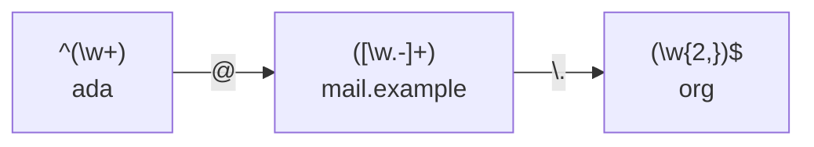

Test expressions interactively on [regex101](https://regex101.com/); it explains every token and supports the different
flavors.

## Example

How `^(\w+)@([\w.-]+)\.(\w{2,})$` matches `ada@mail.example.org`:

`[\w.-]+` is greedy and first takes `mail.example.org`, then gives characters back until `\.(\w{2,})$` can match the end.

## Characters

| Expression       | Matches                                           |
| ---------------- | ------------------------------------------------- |
| `.`              | Any character except a newline.                   |
| `\d`, `\D`       | A digit, anything but a digit.                    |
| `\w`, `\W`       | A letter, digit or underscore, anything else.     |
| `\s`, `\S`       | Whitespace (space, tab, newline), anything else.  |
| `[abc]`          | One of `a`, `b` or `c`.                           |
| `[^abc]`         | Any character except `a`, `b` or `c`.             |
| `[a-zA-Z]`       | A letter in the given ranges.                     |
| `\n`, `\r`, `\t` | Newline, carriage return, tab.                    |
| `\.`             | A literal dot. `\` escapes any special character. |

## Quantifiers

| Expression | Matches the preceding token |
| ---------- | --------------------------- |
| `*`        | 0 or more times             |
| `+`        | 1 or more times             |
| `?`        | 0 or 1 time (optional)      |
| `{3}`      | exactly 3 times             |
| `{3,6}`    | 3 to 6 times                |
| `{3,}`     | 3 or more times             |

Quantifiers are **greedy**: they match as much as possible. Add `?` to make them lazy:

| Text               | Expression | Match         |
| ------------------ | ---------- | ------------- |
| `<b>bold</b> text` | `<.+>`     | `<b>bold</b>` |
| `<b>bold</b> text` | `<.+?>`    | `<b>`         |

## Anchors and groups

| Expression     | Matches                                                       |
| -------------- | ------------------------------------------------------------- |
| `^`, `$`       | Start and end of the string (of each line with the `m` flag). |
| `\b`           | A word boundary: `\bcat\b` matches `cat` but not `concat`.    |
| `a\|b`         | `a` or `b`.                                                   |
| `(abc)`        | A capturing group, available as `\1` or `$1` in replacements. |
| `(?:abc)`      | A group that doesn't capture.                                 |
| `(?<name>abc)` | A named group.                                                |
| `a(?=b)`       | `a` followed by `b`, without consuming `b` (lookahead).       |
| `a(?!b)`       | `a` not followed by `b`.                                      |
| `(?<=b)a`      | `a` preceded by `b` (lookbehind).                             |

## Flags

| Flag | Effect                                                         |
| ---- | -------------------------------------------------------------- |
| `g`  | Global: finds all matches instead of stopping after the first. |
| `i`  | Case-insensitive.                                              |
| `m`  | Multiline: `^` and `$` match at every line break.              |
| `s`  | Dot-all: `.` also matches newlines.                            |

:::caution
Tools speak different dialects. `grep` and `sed` use basic regex by default, where `+`, `?`, `|`, `()` and `{}` must be
escaped; use `grep -E` or `sed -E` for the syntax above. `\d` and lookarounds need `grep -P` (Perl-compatible).
:::
