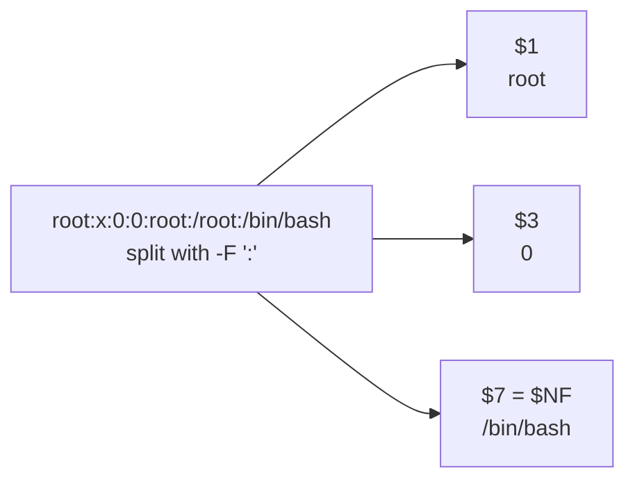

awk reads input line by line (a **record**) and splits each line into **fields** at whitespace, or at the separator
given with `-F`. A program is a list of `pattern { action }` pairs; the action runs for every line that matches the
pattern.

| Command                                       | Effect                                                 |
| --------------------------------------------- | ------------------------------------------------------ |
| `awk '{print $5}' file`                       | Prints the fifth field of every line.                  |
| `awk '/foo/ {print $2}' file`                 | Prints the second field of lines containing `foo`.     |
| `awk -F ',' '{print $NF}' file`               | Prints the last field of comma-separated lines.        |
| `awk -F: '$3 >= 1000 {print $1}' /etc/passwd` | Lists regular users (UID 1000 and above).              |
| `awk 'NR > 1' file`                           | Skips the header line (`NR` is the line number).       |
| `awk 'NF' file`                               | Drops empty lines (`NF` is the number of fields).      |
| `awk '{sum += $1} END {print sum}' file`      | Sums the first column. `END` runs after the last line. |
| `awk '{print $1, $3}' OFS='\t' file`          | Prints two fields separated by a tab.                  |
| `awk '!seen[$0]++' file`                      | Removes duplicate lines while keeping the order.       |

:::tip
Use single quotes around the program so that the shell doesn't expand `$1` and the other field references.
:::
