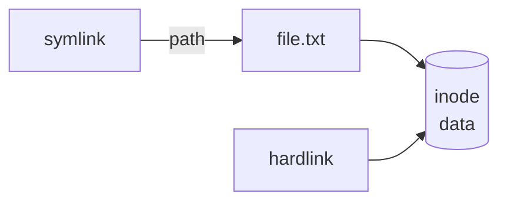

| Command                      | Effect                                                               |
| ---------------------------- | -------------------------------------------------------------------- |
| `cat file`                   | Prints the whole file.                                               |
| `less file`                  | Pages through a file. <kbd>/</kbd> searches, <kbd>q</kbd> quits.     |
| `head -n 10 file`            | Prints the first 10 lines.                                           |
| `tail -n 10 file`            | Prints the last 10 lines.                                            |
| `tail -f file`               | Keeps printing new lines as the file grows, e.g. for logs.           |
| `touch file`                 | Creates an empty file, or updates the timestamps of an existing one. |
| `ln -s /path/to/target link` | Creates a symbolic link `link` pointing to the target.               |
| `stat file`                  | Size, permissions, owner and all timestamps.                         |
| `file file`                  | Detects the file type from the content.                              |

## Hard and symbolic links

A **symbolic link** (`ln -s`) stores a path. It can point to directories and across filesystems, but breaks when the
target is moved or deleted. A **hard link** (`ln`) is a second name for the same inode: the data stays until the last
name is deleted, but it only works within one filesystem and not for directories.

:::tip
Relative symlink targets are resolved from the link's location, not from where you ran `ln`. When in doubt, use
`ln -sr target link`, which calculates the relative path for you.
:::
