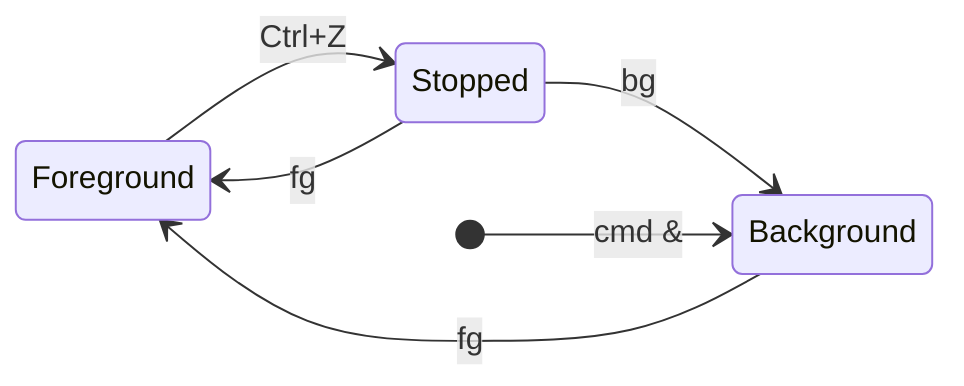

| Command                 | Effect                                                                 |
| ----------------------- | ---------------------------------------------------------------------- |
| `ps aux`                | All processes with CPU, memory and command line.                       |
| `ps -ef --forest`       | All processes as a tree of parents and children.                       |
| `pgrep -a nginx`        | PIDs and command lines of processes matching a name.                   |
| `htop`                  | Interactive viewer; <kbd>F6</kbd> sorts, <kbd>F9</kbd> sends a signal. |
| `kill <pid>`            | Asks a process to terminate (`SIGTERM`).                               |
| `kill -9 <pid>`         | Kills it immediately (`SIGKILL`).                                      |
| `pkill nginx`           | Sends `SIGTERM` to all processes matching a name.                      |
| `nice -n 10 cmd`        | Starts a command with lower priority.                                  |
| `renice -n 10 -p <pid>` | Lowers the priority of a running process.                              |

## Signals

| Signal    | Number | Default effect                                                   |
| --------- | :----: | ---------------------------------------------------------------- |
| `SIGHUP`  |   1    | Terminate. Many daemons reload their configuration instead.      |
| `SIGINT`  |   2    | Terminate; sent by <kbd>Ctrl</kbd>+<kbd>C</kbd>.                 |
| `SIGKILL` |   9    | Terminate immediately. Can't be caught, so no cleanup happens.   |
| `SIGTERM` |   15   | Terminate cleanly. The default of `kill`.                        |
| `SIGSTOP` |   19   | Pause; <kbd>Ctrl</kbd>+<kbd>Z</kbd> sends the similar `SIGTSTP`. |
| `SIGCONT` |   18   | Continue a paused process.                                       |

:::tip
Try `SIGTERM` first and wait a few seconds. `SIGKILL` gives the process no chance to save data or remove lock files.
:::

## Jobs in the shell

| Command       | Effect                                                       |
| ------------- | ------------------------------------------------------------ |
| `cmd &`       | Starts a command in the background.                          |
| `jobs`        | Lists the jobs of the current shell.                         |
| `bg %1`       | Continues job 1 in the background.                           |
| `fg %1`       | Brings job 1 to the foreground.                              |
| `disown %1`   | Detaches a job so it keeps running when the shell is closed. |
| `nohup cmd &` | Starts a command that ignores the hangup when you log out.   |
