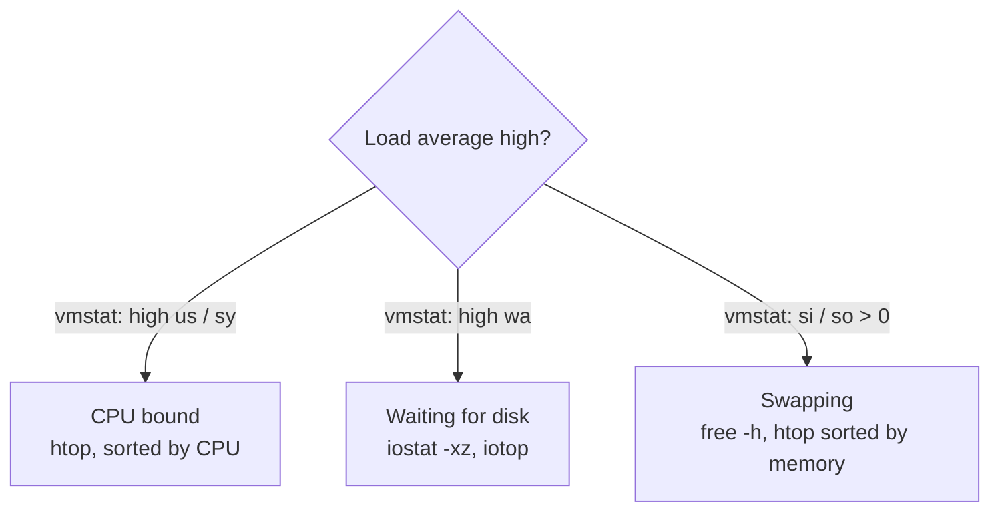

| Command                        | Shows                                                                      |
| ------------------------------ | -------------------------------------------------------------------------- |
| `htop`                         | Interactive overview of CPU, memory and processes.                         |
| `uptime`                       | Load average over 1, 5 and 15 minutes.                                     |
| `vmstat 1`                     | Memory, swap, I/O and CPU every second.                                    |
| `mpstat -P ALL 1`              | Usage per CPU core (package `sysstat`).                                    |
| `iostat -xz 1`                 | Per-disk throughput, latency and utilization (`sysstat`).                  |
| `free -h`                      | Memory usage.                                                              |
| `watch -n 2 df -h`             | Repeats a command every 2 seconds.                                         |
| `sudo iotop`                   | Processes by disk I/O.                                                     |
| `lsof -u user`                 | Files a user has open.                                                     |
| `lsof -i :80`                  | The process using port 80.                                                 |
| `sudo tcpdump -i eth0 port 80` | Captures packets on an interface; `-w file.pcap` saves them for Wireshark. |

## Reading the numbers

- **Load average** counts processes running or waiting for CPU or disk. Compare it with the number of cores (`nproc`):
  a load of 4 on 4 cores is fully used; on 16 cores it's a quarter.
- In `vmstat`, `us`/`sy` are user and kernel CPU time, `wa` is time spent waiting for I/O, and `si`/`so` are pages
  swapped in and out per second. Continuous swapping means memory is too small.
- In `iostat -x`, `%util` near 100 and a growing `aqu-sz` (queue size) mean the disk is saturated.
