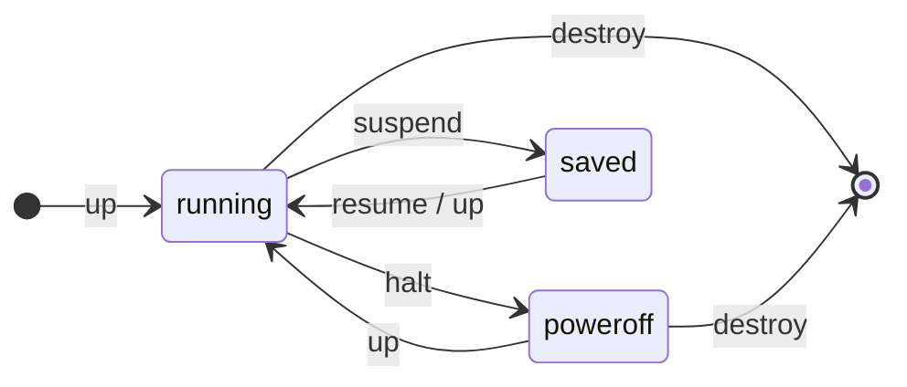

Vagrant creates VMs from a `Vagrantfile` in the current directory. Every command applies to all VMs defined there, or
only to the one named as argument (`vagrant ssh node1`).

| Command                         | Effect                                                             |
| ------------------------------- | ------------------------------------------------------------------ |
| `vagrant up`                    | Creates and provisions the VMs, or starts existing ones.           |
| `vagrant up --provider=libvirt` | Picks the provider (or set `VAGRANT_DEFAULT_PROVIDER`).            |
| `vagrant status`                | State of the VMs in this project.                                  |
| `vagrant global-status --prune` | VMs of all projects on this machine.                               |
| `vagrant ssh [name]`            | Opens a shell in a VM.                                             |
| `vagrant halt`                  | Shuts the VMs down.                                                |
| `vagrant suspend` / `resume`    | Saves the VM state to disk and restores it.                        |
| `vagrant reload`                | Restarts and applies `Vagrantfile` changes (network, CPU, memory). |
| `vagrant provision`             | Runs the provisioners again on running VMs.                        |
| `vagrant destroy -f`            | Deletes the VMs and their disks without asking.                    |
| `vagrant snapshot save <name>`  | Saves a snapshot; `snapshot restore <name>` goes back.             |
| `vagrant ssh-config`            | SSH settings, e.g. for an Ansible inventory or `ssh -F`.           |

## Boxes

| Command                | Effect                                           |
| ---------------------- | ------------------------------------------------ |
| `vagrant box list`     | Downloaded boxes.                                |
| `vagrant box outdated` | Checks whether this project's box has an update. |
| `vagrant box update`   | Downloads the newest version of the box.         |
| `vagrant box prune`    | Deletes old box versions.                        |

:::tip
Provisioners only run on the very first `up`. After changing them, use `vagrant provision`, or
`vagrant reload --provision` if the `Vagrantfile` changed too.
:::
