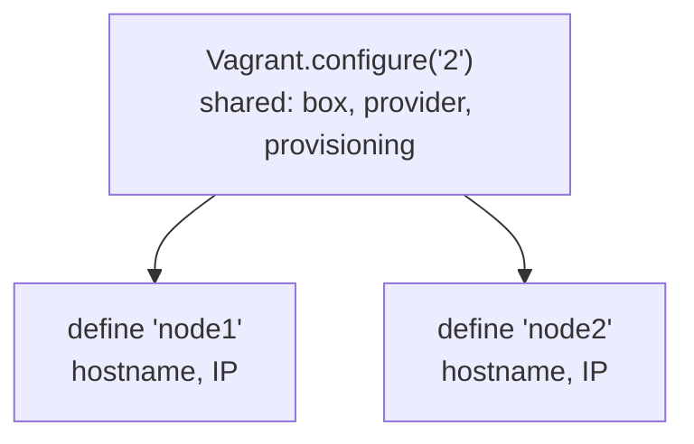

A `Vagrantfile` is Ruby code that describes the VMs of a project. Settings are layered: the outer `config` applies to all
VMs, and each `config.vm.define` block adds the settings of one VM.



## Example

Two VMs on a private network, working with libvirt, VirtualBox and Hyper-V:

```ruby title="Vagrantfile"
NODES = [
  { name: "node1", ip: "10.0.0.11", cpus: 2, memory: 1024 },
  { name: "node2", ip: "10.0.0.12", cpus: 2, memory: 1024 },
]

Vagrant.configure("2") do |config|
  config.vm.box = "fedora/38-cloud-base"

  # Only the block of the provider in use is applied.
  config.vm.provider "libvirt" do |lv|
    lv.qemu_use_session = false
    lv.management_network_device = "virbr0"
  end
  config.vm.provider "virtualbox" do |vb|
    vb.linked_clone = true
  end
  config.vm.provider "hyperv" do |hv|
    hv.linked_clone = true
  end

  config.vm.provision "shell", inline: <<-SHELL
    dnf install -y httpd
    systemctl enable --now httpd
  SHELL

  NODES.each do |node|
    config.vm.define node[:name] do |vm|
      vm.vm.hostname = node[:name]
      vm.vm.network :private_network, ip: node[:ip]

      vm.vm.provider "libvirt" do |lv|
        lv.cpus = node[:cpus]
        lv.memory = node[:memory]
      end
      vm.vm.provider "virtualbox" do |vb|
        vb.cpus = node[:cpus]
        vb.memory = node[:memory]
      end
      vm.vm.provider "hyperv" do |hv|
        hv.cpus = node[:cpus]
        hv.memory = node[:memory]
      end
    end
  end
end
```

Adding a VM only needs a new line in `NODES`.

:::caution
Each VM needs its own host address. A network address like `10.0.0.0` or the same IP on every node leads to errors or
VMs that can't reach each other.
:::

:::tip
Run `vagrant validate` after editing; it catches typos in option names before anything is created.
:::
