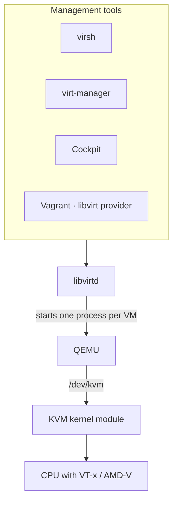

The Linux virtualization stack has distinct layers, and most tools only talk to the one below them.

| Layer   | Role                                                                                                                                                                        |
| ------- | --------------------------------------------------------------------------------------------------------------------------------------------------------------------------- |
| KVM     | Kernel module that runs guest code directly on the CPU using its virtualization extensions.                                                                                 |
| QEMU    | Userspace process per VM that emulates the hardware (disks, network cards, display). Without KVM it can still emulate a whole CPU, also of other architectures, but slowly. |
| libvirt | Daemon with one API for VMs, networks and storage pools. Stores VM definitions as XML.                                                                                      |
| Clients | `virsh` (CLI), virt-manager (GUI), Cockpit (web) and others all go through libvirt, so they see the same VMs.                                                               |

## Checking support

| Command                        | Expected result                                         |
| ------------------------------ | ------------------------------------------------------- |
| `lscpu \| grep Virtualization` | `VT-x` or `AMD-V`. Otherwise enable it in the firmware. |
| `ls -l /dev/kvm`               | The device exists and your user can access it.          |
| `virt-host-validate`           | Checks the host for KVM and libvirt requirements.       |

## virsh

| Command                                    | Effect                                                    |
| ------------------------------------------ | --------------------------------------------------------- |
| `virsh list --all`                         | All VMs, including stopped ones.                          |
| `virsh start <vm>`                         | Starts a VM.                                              |
| `virsh shutdown <vm>`                      | Asks the guest to shut down (ACPI).                       |
| `virsh destroy <vm>`                       | Pulls the plug. The VM is stopped, not deleted.           |
| `virsh undefine <vm> --remove-all-storage` | Deletes the VM and its disks.                             |
| `virsh autostart <vm>`                     | Starts the VM when the host boots.                        |
| `virsh console <vm>`                       | Serial console; leave with <kbd>Ctrl</kbd>+<kbd>\]</kbd>. |
| `virsh edit <vm>`                          | Edits the XML definition.                                 |
| `virsh snapshot-create-as <vm> <name>`     | Creates a snapshot.                                       |
| `virsh domifaddr <vm>`                     | IP addresses of the VM.                                   |
| `virsh net-list --all`                     | Virtual networks.                                         |

:::caution
`virsh` as a normal user connects to `qemu:///session`, a separate per-user set of VMs. Use `sudo virsh` or
`virsh -c qemu:///system` to see the system VMs that virt-manager shows by default.
:::
